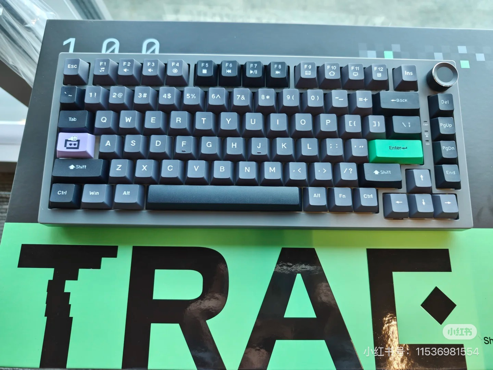
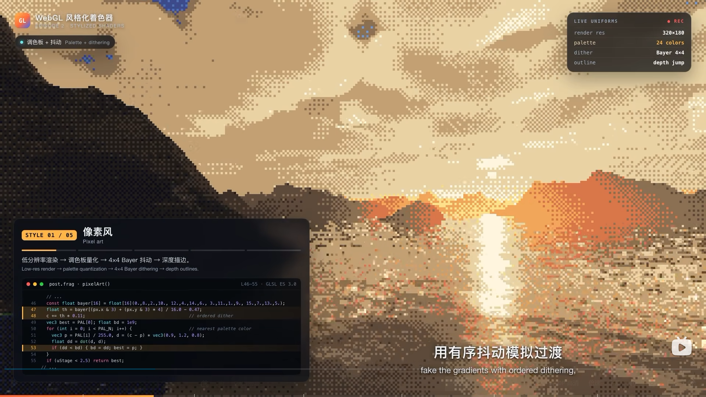
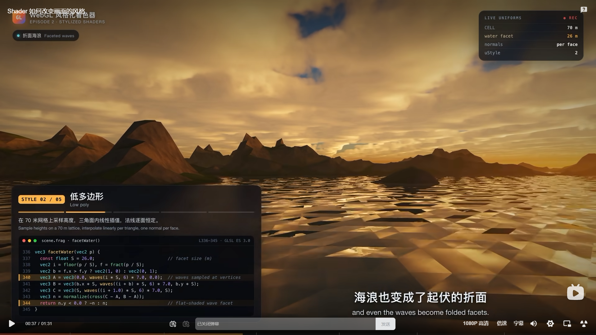
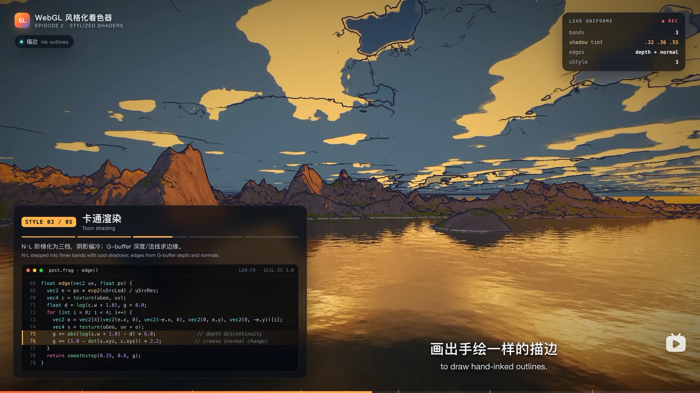
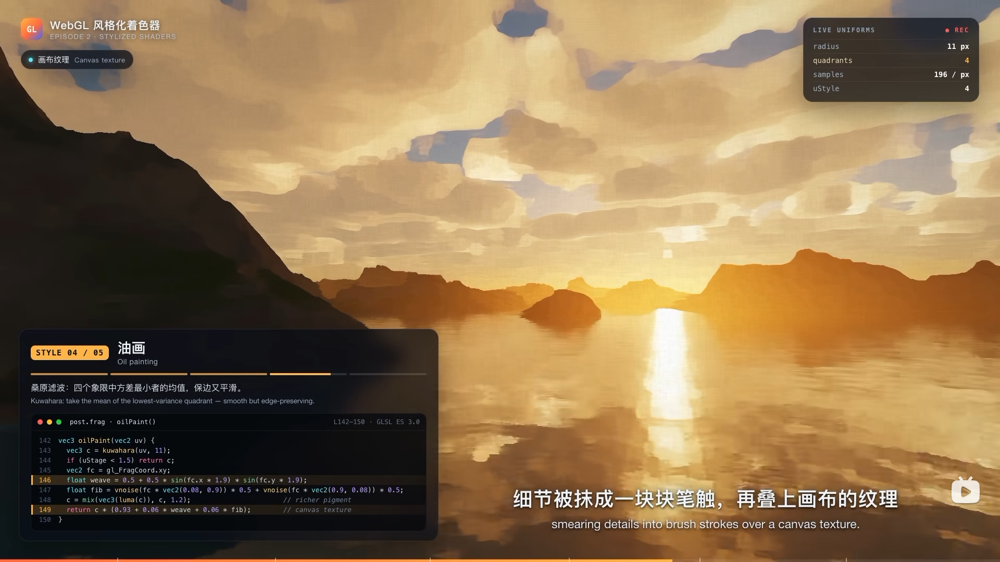
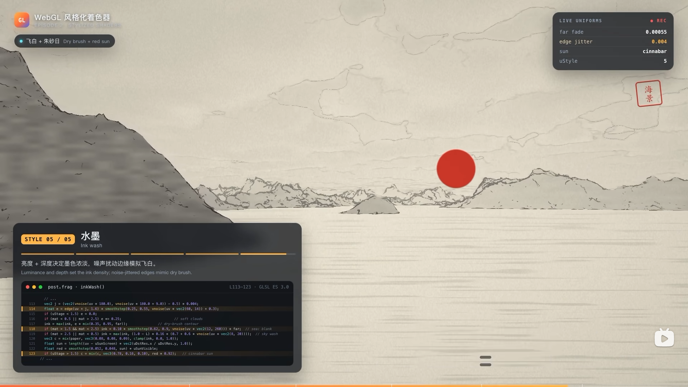

# TRAE 1024 · 敲出你的 TRAE1024

> 一场可切换五种画风的三维品牌仪式：打开页面，机械键盘依次敲下 `T R A E 1 0 2 4`，八枚键帽飞升汇聚成立体 **TRAE1024**；同一个镜头可以在 **像素 / 低多边形 / 卡通 / 油画 / 水墨** 五种画风之间实时重绘。

TRAE 1024 程序员日互动落地页。**纯静态、零依赖、零构建**：HTML + CSS + 原生 JavaScript 三个文件，不使用 Three.js / WebGL，仅凭 CSS 3D、Canvas 2D 与 SVG Filter 在浏览器里完成三维键盘演出与五套风格化渲染。

- 打开即演，无需任何点击即可看完一场完整叙事
- 物理键盘可以「接力」敲入序列，触屏点击键帽同理
- 五风格共用同一套场景几何；**开场后切换到不同画风，会以新画风从头重演一遍仪式**
- 完整状态机、机械键音效（Web Audio 实时合成）、后台冻结、降级与无障碍兜底

| 键盘建模参照 | 像素风 | 低多边形 | 卡通渲染 | 油画 | 水墨 |
| :---: | :---: | :---: | :---: | :---: | :---: |
|  |  |  |  |  |  |
| 实体 75% 配列 | S1 Pixel | S2 Low poly | S3 Toon | S4 Oil | S5 Ink |

> 上图为 `raw/` 中的建模与画风参考素材；完整产品契约见 [PRD](raw/TRAE1024-程序员日互动落地页-PRD.html)（内含可直接操作的评审原型）。

---

## 快速开始

无需安装任何依赖。直接用浏览器打开 [index.html](index.html) 即可（所有资源均为相对路径，`file://` 下也可运行）；或在项目根目录起一个静态服务器：

```bash
# 任选其一
python -m http.server 8080
npx serve .
```

然后访问 `http://localhost:8080`。建议使用最新版桌面 Chrome / Edge / Safari / Firefox，并打开声音以获得完整体验。

**部署**：仓库自带 GitHub Pages 工作流 [.github/workflows/static.yml](.github/workflows/static.yml)，推送到 `main` 即把仓库根目录整体发布到 Pages（无构建步骤），也可在 Actions 页手动触发。

---

## 创意概念

**键盘是程序员的共同图腾。** 品牌已有实体 TRAE 机械键盘与三维透光键帽视觉资产，1024 又是程序员的节日符号——于是活动首页被设计成一次「敲出 TRAE1024」的品牌仪式：

1. **自动上演的仪式**：访客什么都不用做，键盘会以模拟人手的节奏自动敲完 `T R A E 1 0 2 4`；
2. **可以接力，但不会出错**：键盘爱好者可以用自己的物理键盘抢先敲入。序列固定唯一、没有错误分支——品牌仪式不被「按错」打断（零挫败设计）；
3. **一个镜头，五种画风**：敲完后键帽拔离键盘、飞行汇聚成立体 `TRAE1024`，此后镜头可以被五种画风反复重绘。这直接呼应开发者对图形技术的审美兴趣，让同一个首屏「值得反复把玩」；
4. **风格化只作用于三维场景层**：导航、按钮、切换卡等控件恒为深色品牌 UI，保证文案可读、交互可预期。

---

## 五幕演出与状态机

页面由一个显式状态机驱动，`app.js` 中的 `phase` 会被同步为 `<body>` 上的 `phase-*` class，所有分镜、机位、UI 入场全部由 CSS 响应这一个 class：

```
LOADING → OPENING → TYPING → ASSEMBLING → HERO
                       ↑_________________________|  Tab / 重播按钮（保留当前风格）
```

| 状态 | 时长 | 画面与声音 |
| :--- | :--- | :--- |
| **LOADING** | ~1.3s | 近黑底 + 品牌绿点阵粒子，等宽字体阶段文案 `// loading scene` → `// compiling 5 styles` → `// ready`，无假进度条 |
| **OPENING** | 2.5s | 键盘入场、镜头缓推；当前待击键 `T` 进入呼吸态引导视线；按 `T` 可抢先开演 |
| **TYPING** | ~7s + 2.6s | 八键以 800ms ± 90ms 随机间隔逐键敲下（模拟人手），`E` 与 `1` 之间额外停顿 320ms；每键含下沉回弹、背光脉冲、机械音、字符常亮。末键 `4` 敲下后**八键全亮停留 2.6s**（`HOLD_AFTER_TYPED`，让祝福定格）再进入汇聚 |
| **ASSEMBLING** | 2.5s | 八枚键帽拔离键盘，沿弧线飞行排列成立体 `TRAE1024`；实体键盘下沉虚化；伴随 whoosh 汇聚音 |
| **HERO** | 常驻 | 成品悬浮呼吸，可拖拽旋转 / 滚轮缩放；主副标题与「下载 TRAE / 官方中文社区」两个出口常驻；成型时播放三音 chime |

### 操作一览

| 输入 | 生效阶段 | 行为 |
| :--- | :--- | :--- |
| `T R A E 1 0 2 4` | OPENING（仅 `T` 启动）/ TYPING | 接力敲入：当前目标键立即触发并推进；序列中的未来键仅微弱下沉（`tickled`），不判错；无关键忽略。注意 `R` 只是序列键，不再绑定重播 |
| `Tab` 或重播按钮 | 全程 | 重播（保留当前风格，重置键位）；Tab 始终拦截默认焦点跳转，长按时只拦截、不重复重播 |
| `1` – `5` | OPENING / ASSEMBLING / HERO | 直达 S1–S5，**切换到不同风格即以该画风从头重演**；TYPING 阶段数字键让位于序列输入（按下不切换） |
| `←` `→` 或 `[` `]` | 开场后全程 | 切换上 / 下一种风格，不同风格同样触发从头重演 |
| `M` 或喇叭按钮 | 全程 | 声音开关，偏好写入 `localStorage` |
| 鼠标 / 触摸拖拽、滚轮 | HERO | 字形绕 Y 轴旋转（钳制 ±26°）、缩放（0.9–1.12） |
| 点击风格卡分段 / 箭头 | OPENING 起 | 切换风格；选择与当前相同的风格不触发重播 |

---

## 技术架构

约 970 行原生代码，三个文件各司其职：

```
┌────────────────────────────────────────────────────────────┐
│ UI 控件层  topbar / style-card / controls / hint（恒常深色） │  ← 不被风格滤镜影响
├────────────────────────────────────────────────────────────┤
│ #scene  perspective:1400px                                  │
│   └─ #camera  ← filter:url(#f-*)，五风格后期只挂在这一层      │
│        ├─ #board  CSS 3D 机械键盘（数据驱动生成）             │
│        ├─ #fly-layer  WAAPI 飞行键帽（ASSEMBLING）           │
│        └─ #hero  立体 TRAE1024 字槽                          │
├────────────────────────────────────────────────────────────┤
│ #fx  Canvas 2D 粒子 / 代码雨（每风格一套画法与调色板）        │
│ #grain  纹理叠层（扫描线 / 折面光带 / 画布纹 / 宣纸纤维）      │
└────────────────────────────────────────────────────────────┘
```

- [index.html](index.html)：场景骨架、5 个内联 SVG `<filter>`、UI 层、加载与降级态；
- [styles.css](styles.css)：键盘 CSS 3D 建模、键帽三态、分镜机位、五风格换肤、响应式；
- [app.js](app.js)：键盘模型数据、状态机、粒子引擎、Web Audio 合成、输入编排、飞升动画。

唯一的全局状态极小，切换风格/阶段本质上只是重写 `<body>` 的 class 名（`started` 标记开场后切换风格需要重播）：

```js
var state = { phase: 'LOADING', style: 0, pointer: 0, timer: null, started: false };
body.className = 'style-' + STYLES[state.style].id
               + ' phase-' + state.phase.toLowerCase()
               + (reduce ? ' motion-reduce' : '');
```

---

## 关键创意技术细节

### 1. 键盘建模：一份布局 DSL 生成整块 75% 键盘

键盘不在 HTML 里手写，而是由一份**行列数据模型**渲染（见 [app.js](app.js) 中的 `ROWS`）。每个键是一个三元组 `[字符, 宽度(U 数), 角色]`，`G` 是功能区之间的物理间隙：

```js
var G = { g: 1 };
var ROWS = [
  [['Esc',1], G, ['F1'],['F2'],['F3'],['F4'], G, /* …F5–F12… */, G, ['Del',1.25]],
  [['`'],['1'],['2'], /* … */ ,['0'],['-'],['='],['⌫',2]],
  [['Tab',1.5],['Q'],['W'],['E'],['R'],['T'], /* … */ ,['\\',1.5]],
  [['Caps',1.75],['A'],['S'],['D'],['F',1,'novel'], /* … */ ,['Enter',2.25,'enter']],
  [['⇧',2.25],['Z'], /* … */ ,['⇧',2.25],['↑']],
  [['Ctrl',1.25],['Win'],['Alt'],['',6.25,'space'],['Alt'],['Fn'],['Ctrl',1.25],['←'],['↓'],['→']]
];
```

构建时按 span 推导宽度 class（`2.25 → .w225`、`6.25 → .w625`），角色键挂上 `enter`（品牌绿）/ `novel`（个性紫）/ `space` 等 class；八个序列键额外写入 `data-key` 并登记进 `keyEls` 索引，供演出直接寻址。整键尺寸用一个响应式基准单位 `--u` 驱动，移动端只改一个变量即可等比缩小：

```css
.key{--u:min(5.35vmin,50px);width:var(--u);height:var(--u)}
.key.w225{width:calc(var(--u)*2.25)}
.key.w625{width:calc(var(--u)*6.25)}
```

**键帽的「机械结构」是纯 CSS 3D**。每枚键是三层嵌套 DOM，机身整体倾斜摆放：

```html
<button class="key w225 enter"><span class="cap"><i class="face">Enter</i></span></button>
```

```css
#board{transform:perspective(1500px) rotateX(24deg) rotateZ(-4.5deg);transform-style:preserve-3d}
.key{transform-style:preserve-3d}
.key .cap{transform:translateZ(6px)}                 /* 帽体抬离板面 6px，形成立体高度 */
.key .face{box-shadow:0 6px 0 var(--key-side),       /* 6px 硬投影 = 键帽侧壁厚度 */
                    0 7px 9px rgba(0,0,0,.55),
                    inset 0 1px 0 rgba(255,255,255,.08)}  /* 顶面高光 */
.key.pressed .cap{transform:translateZ(1px) translateY(4px)} /* 敲击：Z 轴压回 + 下沉 */
.key.pressed .face{box-shadow:0 2px 0 var(--key-side),0 3px 5px rgba(0,0,0,.5)} /* 侧壁同步变短 */
```

`translateZ` 的行程差 + `box-shadow` 侧壁高度联动，在没有任何图片的情况下给出「键程到底」的机械手感；110ms 后移除 `pressed` 进入 `lit`，完成下沉—回弹—点亮。

**键帽三态**对应 PRD 的仪式规则：

- `.next`：当前待击键，绿色光晕 `breathe` 呼吸动画引导视线；
- `.pressed`：瞬时下沉态；
- `.lit`：已击键常亮背光（七绿一紫，`2` 键追加 `.purple`）；
- `.tickled`：访客提前按了序列中的未来键，仅给 200ms 微弱下沉，不推进、不判错。

### 2. 五风格实时切换：一套几何，三层重映射

切换风格**不重建 DOM、不加载任何资源**，只把 `body` 的 class 换成 `style-pixel / lowpoly / toon / oil / ink`，同一份键盘几何被新画风即时重绘。产品行为上有一个刻意设计：开场后（`state.started`）若切到**不同**风格，`setStyle()` 会调用 `replay()` 以新画风从头重演整场仪式；初始化时的 `setStyle(0)` 与重复选择当前风格都不会触发。画面差异由三个正交层同时响应：

#### 2.1 SVG Filter —— 挂在 `#camera` 上的后期管线

五种滤镜定义在 [index.html](index.html) 顶部的隐藏 SVG 中，通过 `filter:url(#f-*)` 只作用于三维场景层，UI 控件完全不被滤镜改变：

```css
body.style-pixel   #camera{filter:url(#f-pixel)   contrast(1.06) saturate(1.15)}
body.style-lowpoly #camera{filter:url(#f-lowpoly) saturate(1.08) brightness(1.04)}
body.style-toon    #camera{filter:url(#f-toon)    contrast(1.18) saturate(1.25)}
body.style-oil     #camera{filter:url(#f-oil)     saturate(1.08) brightness(1.05)}
body.style-ink     #camera{filter:url(#f-ink)     grayscale(.22) contrast(1.22) brightness(1.45)}
```

技法上用两类 SVG 原语组合，对 PRD 引用的 GPU shader 语言做了原生等价转译：

- **色阶量化（调色板 / 赛璐璐阶调）**——`feComponentTransfer` 的 `discrete` 把每通道连续值压进 4–5 级离散表，渐变即被归并为色块；像素风额外用 `feConvolveMatrix` 做中心锐化，强化阶梯边缘：

```html
<!-- 像素风：RGB 各 5 级有限色阶 -->
<feFuncR type="discrete" tableValues="0 .2 .45 .72 1"/>
<feFuncG type="discrete" tableValues="0 .25 .5 .78 1"/>
<feFuncB type="discrete" tableValues="0 .18 .4 .62 .85"/>
```

- **湍流位移（折面 / 笔触 / 飞白）**——`feTurbulence` 生成分形噪声场，`feDisplacementMap` 沿噪声扭曲像素：低频大位移把画面掰成低多边形折面与油画笔触，高频小位移在水墨风里制造干笔「飞白」边缘；油画前再串联一级 0.55px 高斯柔化，得到保边涂抹感：

```html
<!-- 油画：先柔化，再以低频湍流拉出笔触 -->
<feGaussianBlur stdDeviation="0.55" result="soft"/>
<feTurbulence type="fractalNoise" baseFrequency="0.012" numOctaves="2" seed="11" result="brush"/>
<feDisplacementMap in="soft" in2="brush" scale="9"/>
```

#### 2.2 Canvas 2D 粒子 —— 每风格一套调色板与画法

[app.js](app.js) 中的 `Fx` 模块维护同一组上浮粒子，但**配色表与绘制原语随风格切换**（`setMode` 时整体重新播种）：

| 风格 | 粒子画法 | 代码雨 |
| :--- | :--- | :--- |
| pixel | 坐标吸附到 4px 网格的硬边方块，有限色板 | 绿色 3×26 短竖条 |
| lowpoly | 自转三角面 + 暖金描边，配色加入 `#E8A94B` 暖金 | 暖金色 1.5×42 雨丝 |
| toon | 圆点外加深色墨线描边（`stroke` 勾边） | 绿色 |
| oil | 大尺寸径向渐变软斑（半径 5–18px），模拟笔触团块 | 关闭 |
| ink | 7 段随机半径拼出的粗糙墨点，5% 概率点朱砂红 | 关闭 |

粒子数量按屏幕面积自适应（上限 110 颗），DPR 钳制在 2 以内；`prefers-reduced-motion` 时停止 `requestAnimationFrame`，只绘制一帧静态画面。

#### 2.3 CSS 换肤 —— 环境、纹理与水墨的色彩转译

第三层是环境本身：`body` 背景在五种调性间 0.8s 过渡（深青黑 / 黄昏暖金 / 冷蓝夜空 / 暖棕画室 / 宣纸米白），`#grain` 叠层相应换成像素扫描线、低多边形斜切光带、卡通冷色光晕或油画编织纹。

水墨风的处理最能体现「跨风格品牌识别」的设计判断：不是简单去色，而是做一次**国画颜料翻译**——品牌绿 `#10B981` 转译为石绿/青绿，紫键 `#A855F7` 转译为印章朱砂，HERO 字形反转为宣纸墨色，并在右上角点一枚朱砂红日；而控件层依旧保持深色 UI：

```css
body.style-ink{background:#EAE3D6}
body.style-ink .key.lit .face{background:linear-gradient(180deg,#6FA38B,#3F7059 58%,#2E5744)} /* 绿 → 石绿 */
body.style-ink .key.lit.purple .face{background:linear-gradient(180deg,#DC6A50,#B1402C 58%,#862B1A)} /* 紫 → 朱砂 */
body.style-ink.phase-hero::before{ /* 朱砂红日点睛 */
  content:"";position:absolute;right:9%;top:13%;width:74px;height:74px;border-radius:50%;
  background:radial-gradient(circle at 38% 35%,#E0674A,#B23A28 62%,#8C2A18)}
```

| 风格 | SVG 后期 | 粒子 / 环境语言 | 品牌锚点 |
| :-- | :-- | :-- | :-- |
| S1 像素 Pixel | 5 级色阶量化 + 锐化 | 网格吸附方块、扫描线、代码雨 | 品牌绿以色阶保留 |
| S2 低多边形 Low poly | 湍流位移 scale 7 + 4 级量化 | 三角切面粒子、暖金黄昏 | 绿色背光与暖金交织 |
| S3 卡通 Toon | 5 级阶调 posterize | 墨线描边圆点、冷蓝顶光 | 官方绿色相保持饱和明快 |
| S4 油画 Oil | 柔化 + 湍流位移 scale 9 | 软团笔触、画布纹、暖棕调 | 背光与字符允许笔触化但保持可辨 |
| S5 水墨 Ink | 高频飞白位移 + 提亮降饱和 | 糙边墨点、宣纸纤维、朱砂点 | 绿→石绿、紫→朱砂，字形可识别为下限 |

### 3. 八键敲击演出：随机节奏与零挫败输入

自动节奏集中在 `strike()`（带 `i` 越界守卫）：每键 800ms 间隔叠加 ±90ms 均匀抖动模拟人手，敲完 `E`（序列下标 3）后插入 320ms 分组停顿；末键 `4` 点亮后不立即飞走，而是八键全亮停留 `HOLD_AFTER_TYPED = 2600ms`，给祝福语一个定格节拍，再进入 ASSEMBLING。输入仲裁遵循 PRD 的「仪式完整性」原则：当前目标键清掉自动定时器立即触发；未来键只加 `tickled`；无关键直接忽略；`e.repeat` 丢弃，快速乱按也不会跳键或重入。切到后台标签页时 `clearTimer` 挂起，回前台从被暂停处继续——停留在 TYPING 中段则续敲，恰好停在末键后的定格段则 400ms 后直接汇聚，不补演、不补音。

### 4. ASSEMBLING：FLIP 测量 + WAAPI 弧线飞行

键帽汇聚不是预设路径，而是运行时测量：取源键帽与 HERO 目标字槽的 `getBoundingClientRect()`，在固定定位的 `#fly-layer` 里生成同尺寸飞行体，用 Web Animations API 播一条三关键帧弧线——起点为键帽中心，控制点抬升 130px 并带 ±9° 翻转，终点落入字槽并缩放到槽位尺寸，8 枚键以 85ms 错峰起飞（1050ms 时长）。

进入 HERO 时**不依赖飞行动画回调**，而是确定性地按序列填充八个字槽：这样即使在后台标签页或节流场景下 `onfinish` 不触发，成品也必然成型。原键盘则在同一时刻靠 `.phase-assembling / .phase-hero` 的机位变换下沉、倾斜、虚化退场。

### 5. Web Audio 实时合成的「麻将音」

没有任何音频文件，8 次敲击声由三段合成叠加（`Snd.click(n)`），每次随机力度（0.75–1.25）与基频微抖（基准 208Hz，按键序偏移），避免机械重复：

1. **帽壁撞击瞬态**：40ms 白噪声经 highpass 2.8kHz + bandpass 4.8kHz，指数衰减——清脆的高频「咔」；
2. **腔体共鸣**：1 / 1.52 / 2.24 / 3.09 倍频的**非谐波分音**（sine/triangle，120ms 下滑 8%），密实而不歌唱，模拟客制化键盘的 thock「麻将音」；
3. **低频触底**：108→78Hz 的极短 sine 闷响，给出键程到底的分量。

另有汇聚时的 bandpass 扫频噪声 `whoosh`（300→2400Hz / 1.1s）与成型时的 C5-E5-G5 三音 `chime`。整条总线挂 `DynamicsCompressor` 防爆音；遵循浏览器自动播放策略，首次任意交互后才 `resume()` AudioContext。

### 6. 分镜即机位：用一个元素的 transform 拍完五幕戏

镜头语言全部收敛在 `#board-wrap` 一条 CSS 过渡（`transform 1.25s cubic-bezier(.55,0,.15,1)`）上，由 phase class 切换关键帧，零 JS 动画：

| phase | 机位 transform | 意图 |
| :-- | :-- | :-- |
| opening | `translateY(5vh) scale(1)` | 键盘落位 |
| typing | `translateY(-1vh) scale(1.07)` | 缓推贴近键位区 |
| assembling | `translateY(30vh) rotateX(18deg) scale(.86)` + blur 3px，opacity .4 | 键盘后退虚化，把舞台让给飞行键帽 |
| hero | `translateY(62vh) rotateX(26deg) scale(.78)` + blur 6px，opacity 0 | 沉入画面下方消失 |

### 7. 性能、降级与无障碍

- **静默性能策略**：粒子数按屏面积自适应、DPR ≤ 2、`will-change` 只挂在真正做 3D/动画的元素上；
- **`prefers-reduced-motion`**：`.motion-reduce` 全局把动画/过渡压到瞬时，LOADING 后直达 HERO，关闭 SVG 滤镜与粒子循环，呼吸、机位运动全部跳过；
- **致命降级**：Canvas 2D 上下文不可用时显示 `#fallback` 卡片——成型态品牌字 + 两个转化出口 + 重试按钮，不白屏；
- **可访问性**：风格卡使用 `tablist`/`tab` 语义与 `aria-selected`，状态不以颜色为唯一信号（带 01–05 编号），声音有两态图标，键帽有 `:focus-visible` 轮廓；
- **响应式**：820px / 430px 两级断点，移动端键盘改正视角、缩小 `--u`，风格卡变底部通栏，主角键位始终在安全区内。

---

## 目录结构

```
TRAE-2026-1024/
├─ index.html        # 页面骨架 + 5 个内联 SVG 风格滤镜
├─ styles.css        # CSS 3D 键盘、三态、机位分镜、五风格换肤、响应式
├─ app.js            # 布局 DSL、状态机、粒子引擎、Web Audio、飞升动画
├─ .github/workflows/static.yml   # 推送 main 自动发布 GitHub Pages（无构建）
├─ .trae/rules/project_rules.md   # 项目级开发规则（改代码前先读）
├─ assets/           # favicon、TRAE 品牌标识（运行时唯一允许引用的图片目录）
└─ raw/              # 设计输入物（不参与运行时）
   ├─ TRAE1024-程序员日互动落地页-PRD.html   # PRD v0.1，含两个可交互评审原型
   ├─ TRAE-Keyboard.jpg                     # 键盘建模参照（75% 配列 / 绿 Enter / 紫个性键 / 旋钮）
   ├─ 1024-banner.png                       # 透光键帽、日期装饰与 slogan 事实来源
   ├─ 00-TRAE.png
   └─ 01-像素风.png … 05-水墨.png            # 五种画风的画面对齐参考
```

品牌出口：[下载 TRAE](https://www.trae.cn/) 与 [官方中文社区](https://forum.trae.cn/)，均以新窗口打开。

---

## 与 PRD 的实现取舍

PRD 以 WebGL 着色器技法作为**画面效果对齐语言**（320×180 低分辨率渲染 + Bayer 抖动、flat shading、G-buffer 描边、Kuwahara 滤波、亮度/深度控墨），但不指定实现路径。本实现刻意不引入 Three.js 等任何运行时库，而是用浏览器原生能力完成等价转译：

| PRD 中的 shader 语言 | 本实现的原生方案 |
| :-- | :-- |
| 低分辨率渲染 + 调色板量化 + 抖动 | `feComponentTransfer discrete` 色阶归并 + 网格吸附像素粒子 + 扫描线叠层 |
| Flat shading 三角折面 | 低频 `feTurbulence` + `feDisplacementMap` 几何位移 + 三角面粒子 |
| N·L 三档阶调 + 描边 | 多级离散色阶 posterize + 粒子勾边 |
| Kuwahara 保边笔触 | 微高斯柔化 + 湍流位移（scale 9）+ 画布纹理 |
| 亮度/深度控墨、飞白、朱砂 | 高频湍流位移 + 提亮降饱和 + 石绿/朱砂 CSS 色彩转译 |

收益是：首屏零第三方库下载、三文件可整体离线打开、风格切换只改一个 class 即可即时重绘；代价是后期精度接近「风格化海报」而非逐像素 shader 仿真——这与活动页「仪式感 + 可把玩」的目标一致。

相对 PRD v0.1 另有三处**刻意的产品偏离**（代码现状为准）：

1. **切换风格会从头重演**：PRD 原要求切换不中断、不重置序列；现实现改为开场后切到不同风格即 `replay()`，让访客能用新画风看完整场仪式，而非只看到 HERO 一个镜头；
2. **重播键改为 `Tab`**：PRD 快捷键表定义的是 `R`，但 `R` 同时是敲击序列的第二键，实测容易在接力输入时误触发重播，故改为 Tab 并始终拦截其默认焦点跳转，`R` 回归纯序列键；
3. **末键后停留 2.6s**：PRD 只写「保持一拍」，实现拉长为 `HOLD_AFTER_TYPED = 2600ms`，让八键全亮的祝福语定格后再汇聚。

其余 PRD 决策按 v0.1 落地：像素风默认开场、七绿一紫背光、重播保留当前风格、`localStorage` 静音记忆；P1 项（LIVE UNIFORMS 参数面板、分享卡、氛围配乐等）未实现。

---

## 浏览器支持

最新两个大版本的 Chrome / Edge / Safari / Firefox（需支持 CSS 3D Transform、SVG Filter 与 Web Audio）。不支持 IE；不支持 Canvas 2D 的环境自动进入降级卡片。品牌标识与键帽素材版权归 TRAE 所有。
